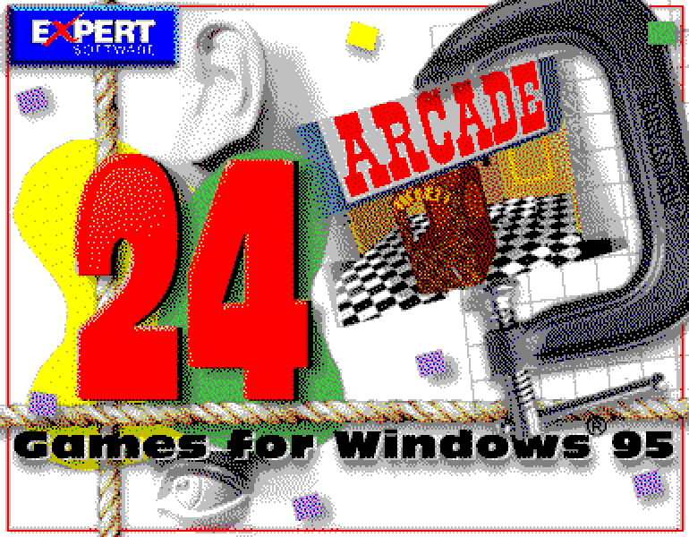
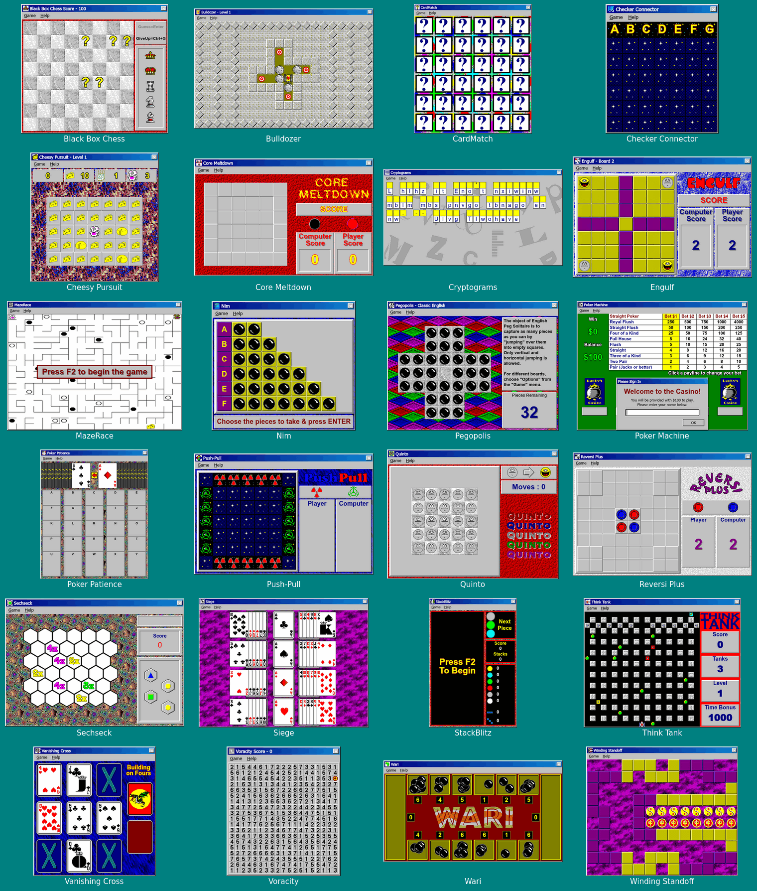

# 24Games

> [!NOTE]
> This project was created with [Anthropic Claude](https://www.anthropic.com/claude).



The 24 games of _24 Games for Windows 95_ (Expert Software, 1995; games by The Code Zone),
reverse-engineered from the original executables and rewritten for the browser. They run on any
modern desktop, tablet or phone, without Windows or an emulator, and play like the originals:
same rules, same computer opponents, same options, dialogs, art and sounds.

> [!IMPORTANT]
> _24 Games for Windows 95_ is © 1995 Expert Software, Inc.; **"24 Games" and the Expert logo are
> trademarks of Expert Software, Inc.** The games' art, sounds and texts are © 1995 The Code Zone.
> This project is not affiliated with either. The original files in [original/](original) and the
> assets extracted from them in [src/assets/](src/assets) belong to their owners; the MIT
> [licence](LICENSE) covers only this project's own code.



## Games

The launcher lists the games with the original descriptions and rules; each game's page in
[docs/games/](docs/games) explains how the original works and where the web version differs.

<details>
<summary>The launcher</summary>


</details>

| Game                                       | Type           | What it is                                                          |
| ------------------------------------------ | -------------- | ------------------------------------------------------------------- |
| [Black Box Chess](docs/games/bbchess.md)   | Puzzle         | Deduce the hidden chess pieces from how often squares are attacked  |
| [Bulldozer](docs/games/bulldoze.md)        | Puzzle         | Push the rocks onto the targets: 60 levels, with passwords          |
| [CardMatch](docs/games/match.md)           | Puzzle         | Memory: find the pairs, against the clock, three skill levels       |
| [Checker Connector](docs/games/connect.md) | Board/Strategy | Four in a row against the computer                                  |
| [Cheesy Pursuit](docs/games/cheesy.md)     | Arcade         | A mouse eats the cheese while giant cats chase it                   |
| [Core Meltdown](docs/games/meltdown.md)    | Board/Strategy | Grow your pieces until they explode and take over the board         |
| [Cryptograms](docs/games/crypto.md)        | Puzzle         | Break the substitution code of a famous quotation                   |
| [Engulf](docs/games/engulf.md)             | Board/Strategy | Copy and jump your pieces to capture the computer's                 |
| [MazeRace](docs/games/maze.md)             | Arcade         | Two mice race through a maze to the cheese, one or two players      |
| [Nim](docs/games/nim.md)                   | Board/Strategy | Take pieces from the rows; take, or leave, the last one             |
| [Pegopolis](docs/games/pegoplis.md)        | Puzzle         | Peg solitaire: 23 boards, some with a pattern to reach              |
| [Poker Machine](docs/games/pokermat.md)    | Gambling       | A Las Vegas video poker machine, three variants                     |
| [Poker Patience](docs/games/pokergrd.md)   | Card/Solitaire | Build poker hands in the rows and the columns of a 5×5 grid         |
| [Push-Pull](docs/games/pushpull.md)        | Board/Strategy | Move a shared marker to capture more than the computer              |
| [Quinto](docs/games/quinto.md)             | Puzzle         | Flip every piece of the board: each click flips a cross             |
| [Reversi Plus](docs/games/reversi.md)      | Board/Strategy | Reversi against the computer                                        |
| [Sechseck](docs/games/sechseck.md)         | Arcade         | Place colours and shapes on a hexagon board before skulls appear    |
| [Siege](docs/games/siege.md)               | Card/Solitaire | Solitaire: build the centre column from aces to kings               |
| [StackBlitz](docs/games/stackblz.md)       | Arcade         | Rearrange falling stacks to line up three pieces of a colour        |
| [Think Tank](docs/games/thinktnk.md)       | Arcade         | A tank against many: collect the pellets or destroy the enemies     |
| [Vanishing Cross](docs/games/vcross.md)    | Card/Solitaire | Solitaire: build up the four suits, starting from any card          |
| [Voracity](docs/games/voracity.md)         | Board/Strategy | Eat as many number tiles as you can without boxing yourself in      |
| [Wari](docs/games/wari.md)                 | Board/Strategy | Sow the pits around the board (Kalah) against the computer          |
| [Winding Standoff](docs/games/winding.md)  | Board/Strategy | Slide pieces along a winding board; the first who cannot move loses |

### Differences from the originals

- **Modern platforms:** every game works with a mouse, a keyboard or a finger (drag and drop by
  touch, swipes and an on-screen pad for the arcade games, an on-screen keyboard for
  Cryptograms), and scales to the screen.
- **Settings and high scores** are kept in the browser (the originals used the registry).
- **Help** shows the rules from the launcher; the WinHelp files are not converted yet.
- **Bugs of the originals that spoiled the game are fixed**; the other quirks are kept, and each
  game's page lists them. The fixed ones:

| Game                                    | The original                                                                                       | Here                                               |
| --------------------------------------- | -------------------------------------------------------------------------------------------------- | -------------------------------------------------- |
| [Cryptograms](docs/games/crypto.md)     | A signed overflow in the phrase pick shows the file's first phrase in about half of the games      | Every phrase is equally likely                     |
| [Wari](docs/games/wari.md)              | The search budget table is read one entry too far: Difficult plays better than Expert              | The intended budgets, growing from Easy to Expert  |
| [Nim](docs/games/nim.md)                | With "Leave the Last Piece", taking every remaining piece does not end the game, which then stalls | The game ends, lost by whoever took the last piece |
| [Core Meltdown](docs/games/meltdown.md) | With "Computer Goes First", the computer's opening square stays clickable, and clicking it loses   | The computer's square cannot be clicked            |

Bulldozer also keeps the current level across visits, and does not show the garbage password
the original gives after level 59. The design decisions are in [DECISIONS.md](DECISIONS.md).

## How it was made

The games are C++ programs built on StarView 2.21. Their art, levels and texts were extracted
from the executables' resources by [scripts/](scripts) (PE, bitmap and icon readers in plain
TypeScript); their code was decompiled with Ghidra, and the rules, computer players, timings and
scoring were rewritten from it, then compared with the originals running under Wine. See
[docs/reverse-engineering.md](docs/reverse-engineering.md) and [docs/porting.md](docs/porting.md).

## Development

Node 26 (`.nvmrc`).

```sh
npm ci
npm run dev                 # http://localhost:5173
npm run check               # typecheck, lint, format check, tests
npm run build               # static site in dist/
npm run assets              # re-extract src/assets from original/
npm run assets -- bulldoze  # one game's assets only
```

| Path                          | What                                                                  |
| ----------------------------- | --------------------------------------------------------------------- |
| [original/](original)         | The original Windows 95 files, unmodified                             |
| [scripts/](scripts)           | Asset extraction: shared assets, and one module per game              |
| [src/shell/](src/shell)       | Windows 95 chrome, and what the games share (dialogs, scores, cards…) |
| [src/launcher/](src/launcher) | The game browser of `games.exe`                                       |
| [src/games/](src/games)       | One directory per game, named after its executable                    |
| [tools/re/](tools/re)         | Reverse-engineering helpers: Ghidra script, Wine screenshots          |
| [docs/](docs)                 | Reverse engineering, porting conventions, one page per game           |

## Deployment

The image serves the static site with nginx, as a non-root user, on port 8080:

```yaml
services:
  24games:
    image: ghcr.io/sebastka/24games:edge
    ports: ['8080:8080']
    read_only: true
    tmpfs: [/tmp]
    cap_drop: [ALL]
    security_opt: ['no-new-privileges:true']
```

`/healthz` answers `ok`. Pushes to `master` publish `edge`; running the Release workflow publishes
a dated release (`YYYY-MM-DD`) and `latest`, signed with cosign. Locally: `docker compose up -d
--build` (http://localhost:8080).
