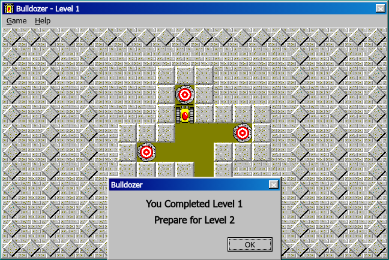
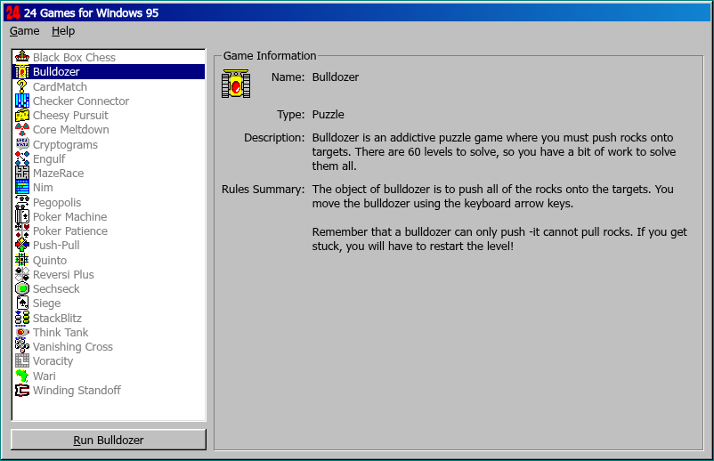
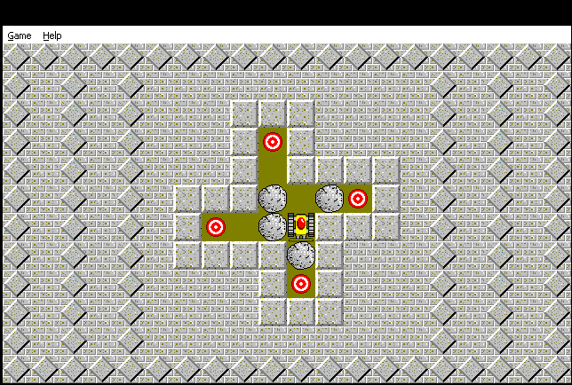
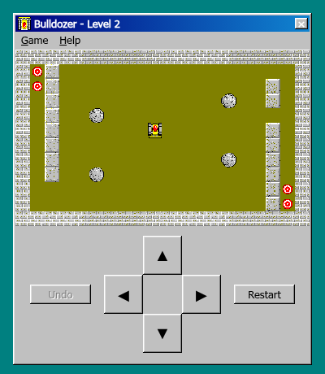

# 24Games

> [!NOTE]
> This project was created with [Anthropic Claude](https://www.anthropic.com/claude).

The games of _24 Games for Windows 95_ (Expert Software, 1995; games by The Code Zone),
reverse-engineered and rewritten for the browser: they run on any modern desktop or phone,
without Windows or an emulator.

> [!IMPORTANT]
> _24 Games for Windows 95_ is © 1995 Expert Software, Inc.; **"24 Games" and the Expert logo are
> trademarks of Expert Software, Inc.** The games' art, sounds and texts are © 1995 The Code Zone.
> This project is not affiliated with either. The original files in [original/](original) and the
> assets extracted from them in [src/assets/](src/assets) belong to their owners; the MIT
> [licence](LICENSE) covers only this project's own code.



<details>
<summary>The launcher, the original under Wine, and a phone</summary>







</details>

## Games

All 24 games are playable, each with the original's rules, computer opponents, options, dialogs,
sounds and art; each game's notes (how the original works, deviations) are in
[docs/games/](docs/games):

- **Arcade:** Cheesy Pursuit, MazeRace (one or two players), StackBlitz, Sechseck, Think Tank.
- **Board and strategy:** Checker Connector, Core Meltdown, Engulf, Nim, Push-Pull, Reversi Plus,
  Voracity, Wari, Winding Standoff.
- **Card and solitaire:** Poker Patience, Siege, Vanishing Cross.
- **Gambling:** Poker Machine.
- **Puzzle:** Black Box Chess, Bulldozer, CardMatch, Cryptograms, Pegopolis, Quinto.

**Bulldozer** plays as the original: arrow keys (or swipes, or the on-screen pad on a touch
screen), F2 to restart the level, Ctrl+Z to undo the last push, a password every fourth level,
and the original's options: starting level, colour or monochrome pieces, 31 backgrounds, and a
sound per event. Deviations from the original are listed in [DECISIONS.md](DECISIONS.md) (D7).

## Development

Node 26 (`.nvmrc`).

```sh
npm ci
npm run dev       # http://localhost:5173
npm run check     # typecheck, lint, format check, tests
npm run build     # static site in dist/
npm run assets    # re-extract src/assets from original/ (after changing scripts/)
```

| Path                                                       | What                                                          |
| ---------------------------------------------------------- | ------------------------------------------------------------- |
| [original/](original)                                      | The original Windows 95 files, unmodified                     |
| [scripts/](scripts)                                        | Asset extraction: PE resources, bitmaps, icons → PNG and JSON |
| [src/shell/](src/shell)                                    | Windows 95 chrome, sounds, backgrounds, settings, catalogue   |
| [src/launcher/](src/launcher)                              | The game browser of `games.exe`                               |
| [src/games/](src/games)                                    | One directory per game: pure rules, canvas, dialogs           |
| [tools/re/](tools/re)                                      | Reverse-engineering helpers: Ghidra script, Wine screenshots  |
| [docs/reverse-engineering.md](docs/reverse-engineering.md) | How the originals were taken apart, and what was found        |

Porting another game: decompile it (see [docs/reverse-engineering.md](docs/reverse-engineering.md)),
extract its assets in `scripts/extract-assets.ts`, write its rules as a pure module with tests,
and register its component in [src/games/index.ts](src/games/index.ts).

## Deployment

The image serves the static site with nginx, as a non-root user, on port 8080:

```yaml
services:
  24games:
    image: ghcr.io/sebastka/24games:edge
    ports: ['8080:8080']
    read_only: true
    tmpfs: [/tmp]
    cap_drop: [ALL]
    security_opt: ['no-new-privileges:true']
```

`/healthz` answers `ok`. Pushes to `master` publish `edge`; running the Release workflow publishes
a dated release (`YYYY-MM-DD`) and `latest`, signed with cosign. Locally: `docker compose up -d
--build` (http://localhost:8080).
